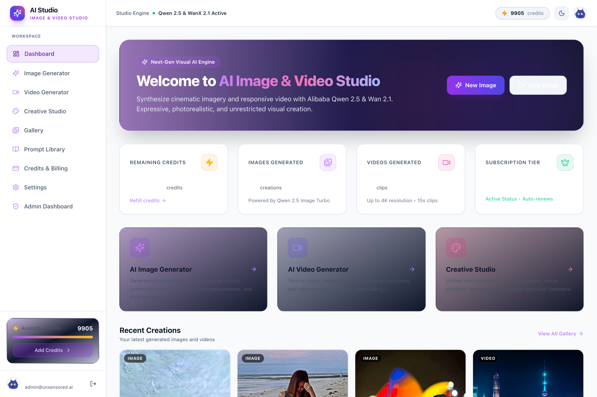
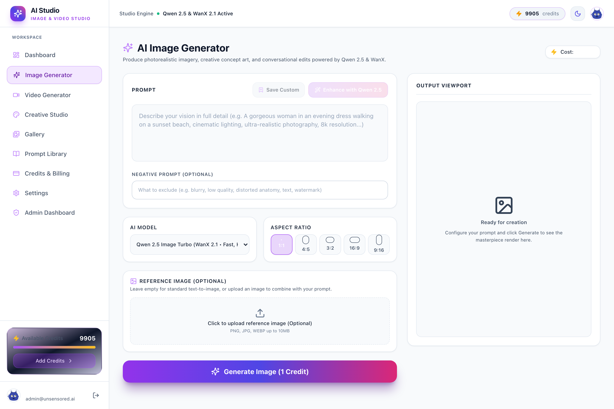
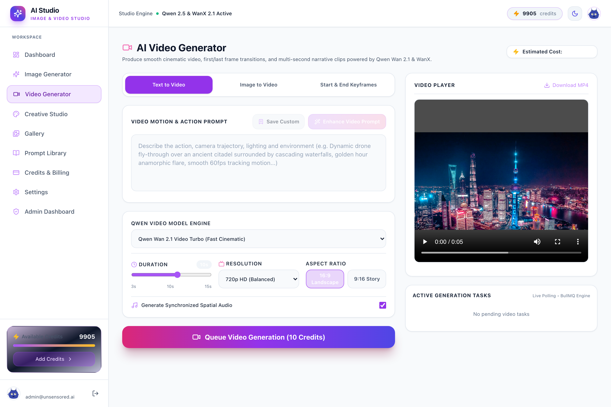
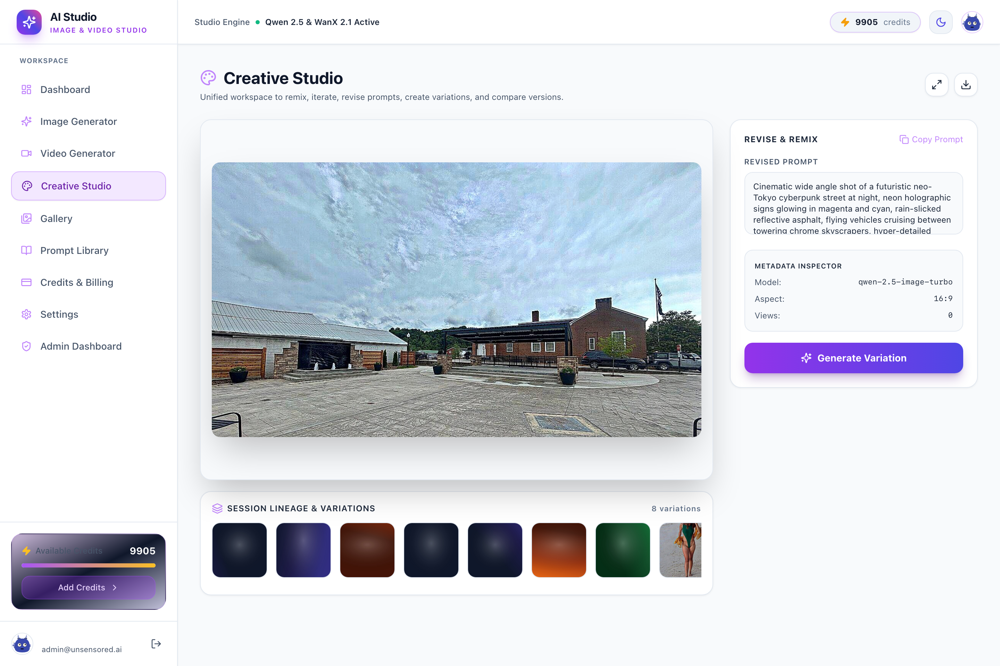
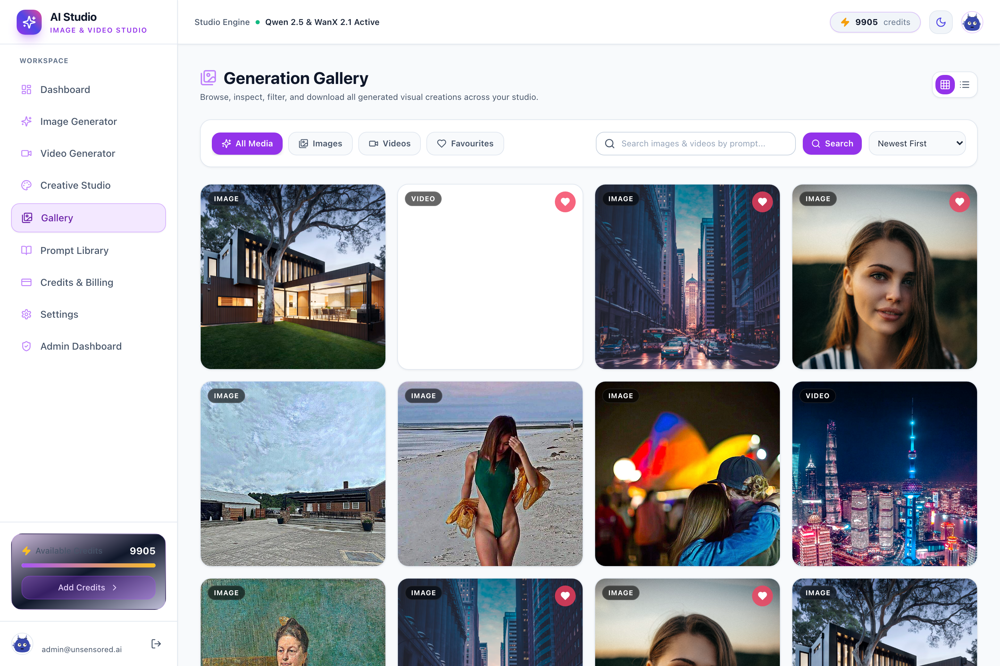
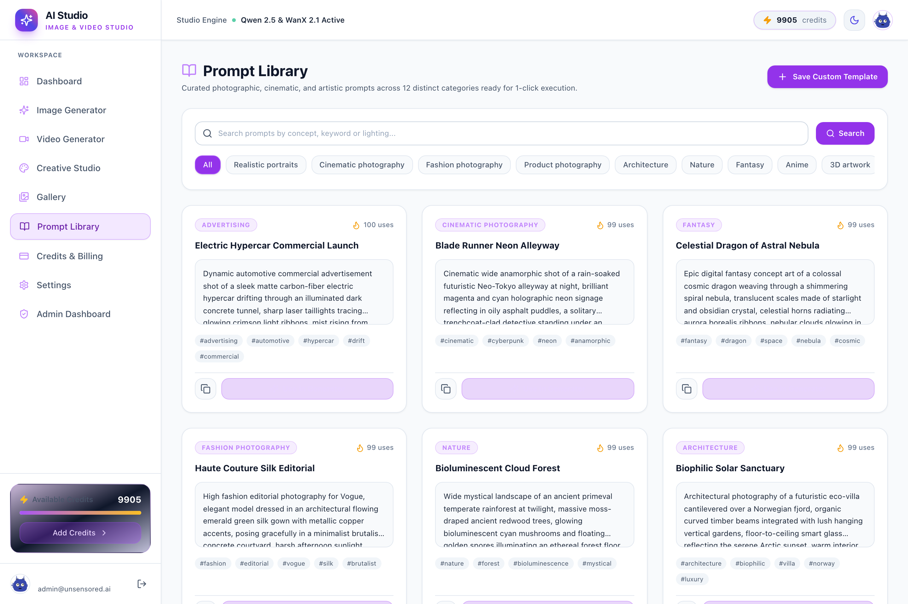
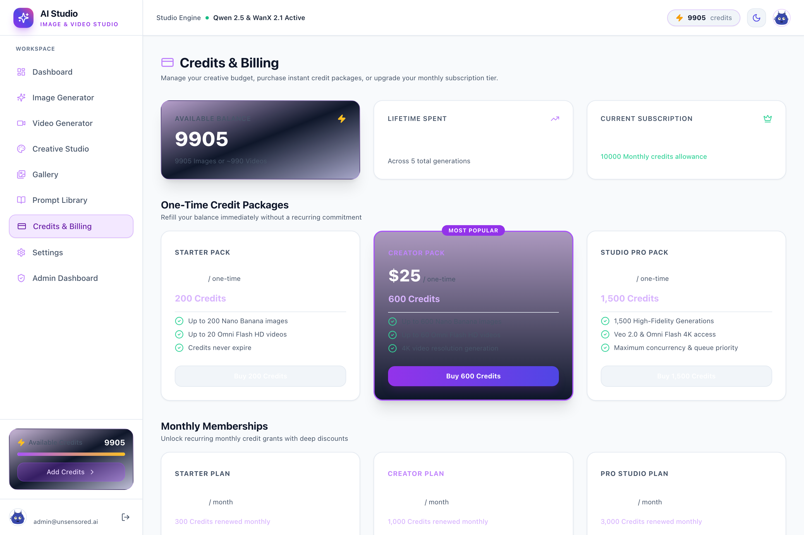
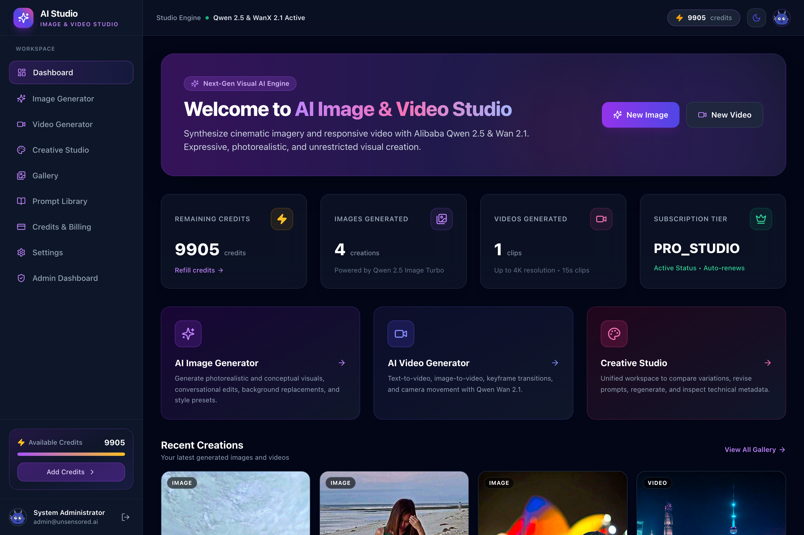

# AI Image & Video Studio

[](https://github.com/VirendraArekar/ai-image-video-studio)
[](https://nestjs.com/)
[](https://react.dev/)
[](https://www.typescriptlang.org/)
[](https://www.prisma.io/)
[](https://aistudio.google.com/)

A commercial-grade, production-ready SaaS web application powered by **Alibaba Qwen 2.5 & WanX AI**. **AI Image & Video Studio** delivers a creative-first, high-fidelity generative visual experience for synthesizing, editing, transforming, and managing photorealistic and stylized AI imagery and cinematic video clips.

---

## 📸 Application Screenshots & UI Showcase

### ☀️ Light Theme (All Workspaces & Views)

#### 1. 📊 Executive Dashboard (Light Theme)


#### 2. 🎨 AI Image Generator Workspace (Light Theme)


#### 3. 🎬 AI Video Generator Workspace (Light Theme)


#### 4. 🔮 Creative Studio Canvas & Lineage (Light Theme)


#### 5. 🖼️ Generation Gallery with Dynamic Search & Filters (Light Theme)


#### 6. 📚 Searchable Prompt Library & Custom Templates (Light Theme)


#### 7. 💳 Credits & Billing Studio (Light Theme)


---

### 🌙 Dark Theme Showcase

#### 📊 Executive Dashboard (Dark Theme)


---

## 🌟 Key Application Modules

### 1. 📊 Executive Dashboard
- Real-time generation statistics: Total generated images, videos, and remaining generation credits.
- Dynamic subscription status indicator (Free, Starter, Creator, Pro Studio).
- Interactive recent generation carousel with instant preview, zoom, and metadata inspector.
- 1-click quick action portals to image and video workspaces.

### 2. 🎨 AI Image Generator Workspace
- **Multi-Modal Generation**:
  - **Text-to-Image**: High-fidelity synthesis using Gemini Nano Banana 2.1, Gemini 3 Pro Image (Nano Banana Pro), Gemini 3.1 Flash-Lite, and Google Imagen 3.
  - **Image-to-Image & Conversational Editing**: Upload reference images with multi-reference fusion, background replacement, clean background removal, and face/detail enhancement.
- **Prompt Enhancement Engine**: 1-click "Enhance with Gemini" powered by `gemini-4-hydrogen` to transform short concepts into rich cinematic prompts.
- **Granular Controls**:
  - Aspect Ratios: `1:1 Square`, `4:5 Social`, `3:2 Classic`, `16:9 Cinema`, `9:16 Story`.
  - 10 Curated Style Presets (Cinematic, Photorealistic, Anime/Manga, Cyberpunk, 3D Octane, Fantasy Art, Haute Fashion, Product Studio, Vintage, Watercolor).
  - Negative prompts, sample count, and live credit cost estimation.

### 3. 🎬 AI Video Generator Workspace
- **Generative Modes**:
  - **Text-to-Video**: Narrative scene generation from descriptive text prompts.
  - **Image-to-Video**: Animate starting still images into fluid cinematic camera shots.
  - **Start & End Keyframe Interpolation**: Generate smooth transitions between two uploaded keyframe images.
  - **Reference-Guided & Video Extensions**: Extend existing clips up to 15–30 seconds.
- **Video Controls**:
  - Duration: 3 to 15 seconds.
  - Resolution: `360p` (Fast), `720p HD` (Balanced), `1080p Full HD`, and `4K Ultra HD`.
  - Aspect Ratio: `16:9 Landscape` and `9:16 Portrait`.
  - Synchronized spatial audio toggle.
- **Asynchronous Telemetry**:
  - Background queueing with BullMQ and Redis.
  - Live polling progress bar (15% -> 50% -> 80% -> 100%).
  - HTML5 video player with loop, controls, and direct MP4 file downloads.

### 4. 🔮 Creative Studio
- Unified editing and remixing canvas for existing images and videos.
- Side-by-side variation generation with parameter tweak, seed permutation, and style shifts.
- Session lineage and branch history drawer to trace every creative iteration.
- Raw metadata inspection: model, seed, guidance, aspect ratio, prompt, resolution.

### 5. 📚 Searchable Prompt Library
- 12 Curated categories: *Realistic portraits, Cinematic photography, Fashion photography, Product photography, Architecture, Nature, Fantasy, Anime, 3D artwork, Advertising, Social media, Video storytelling*.
- 1-Click "Use in Generator" directly populates the Image or Video generator workspace.
- Save custom prompt templates with tags and categories.

### 6. 🖼️ Generation Gallery
- Filter tabs: All Media, Images, Videos, and Favourites.
- Full-text search and multi-criteria sorting (Newest, Oldest, Views, Downloads).
- Responsive masonry grid and list views.
- Full-screen lightbox modal with parameter breakdown, download button, and studio remix trigger.

### 7. 💳 Credits & Subscription System
- **Transparent Credit Economy**:
  - Welcome gift: 50 free credits on registration.
  - Dynamic pricing calculation based on model complexity, video duration, and resolution.
  - Atomically protected credit transactions via Prisma `$transaction`.
  - Automatic refund upon generation failure.
- **One-time Credit Refills**: Starter Pack (200 credits / $10), Creator Pack (600 credits / $25), Studio Pro Pack (1,500 credits / $50).
- **Monthly Memberships**: Starter ($15/mo), Creator ($39/mo), Pro Studio ($99/mo).

### 8. 🛡️ Admin Governance & Monitoring
- Global analytics: Total users, generations, API credit burn rate, and job success rate.
- User management: Search, inspect usage, suspend/activate accounts, and adjust credits manually.
- Live job queue monitoring: Active, completed, and failed job execution logs.
- Immutable administrative audit logs.

---

## 🛠️ Technology Stack

```
├── Frontend (React 18 + TypeScript + Vite)
│   ├── Styling: Tailwind CSS + Custom Glassmorphism UI
│   ├── State: Redux Toolkit (Auth, UI, Generation slices)
│   ├── Icons: Lucide React
│   ├── Forms & Validation: React Hook Form + Zod
│   └── Networking: Axios with automatic JWT refresh token interceptor
│
├── Backend (NestJS 11 + TypeScript)
│   ├── Architecture: Modular REST API + Adapter Pattern
│   ├── Primary Database: MySQL 8.0 via Prisma ORM
│   ├── Queue & Cache: Redis + BullMQ asynchronous workers
│   ├── Authentication: Passport JWT (Access + Refresh Token rotation, bcrypt)
│   ├── Validation: class-validator + class-transformer
│   ├── Security: Helmet headers, NestJS Throttler rate limiting, CORS
│   └── Documentation: Swagger OpenAPI UI (/api/docs)
│
├── AI Integration (Alibaba Qwen 2.5 & WanX 2.1 API)
│   ├── Image Models: qwen-2.5-image-turbo, wanx2.1-t2i-turbo, wanx2.1-t2i-plus
│   ├── Video Models: qwen-wan2.1-video-turbo (24fps Ken Burns camera motion & spatial audio)
│   └── Prompt Enhancer: qwen-2.5-coder-32b / gemini-4-hydrogen fallback
│
└── Infrastructure & Storage
    ├── Multi-stage Docker & docker-compose.yml
    ├── Object Storage: AWS S3-compatible client (AWS S3 / MinIO) + Local Disk fallback
    └── Web Server: Nginx reverse proxy
```

---

## 🚀 1-Command Full Docker Setup (Turnkey)

Run the entire platform (MySQL, Redis, NestJS Backend with automatic DB migration & seeding, and React Frontend) inside Docker:

```bash
docker compose up -d --build
```

That's it! Everything starts automatically:
- 🌐 **Frontend Application**: `http://localhost` (also mapped to `http://localhost:5173`)
- ⚙️ **Backend REST API**: `http://localhost:3000`
- 📚 **Swagger OpenAPI Docs**: `http://localhost:3000/api/docs`
- 🗄️ **Database**: Automatically migrated and seeded with Admin and Creator demo accounts

To view real-time logs across all services:
```bash
docker compose logs -f
```

To stop all containers:
```bash
docker compose down
```

---

## 🔑 Demo Accounts
The database seed script sets up two ready-to-test accounts:

| Role | Email | Password | Initial Credits |
|---|---|---|---|
| **Administrator** | `admin@aistudio.com` | `AdminSecret123!` | 10,000 Credits |
| **Creator User** | `creator@aistudio.com` | `Creator123!` | 350 Credits |

*A 1-click "Instant Demo Login" button is also provided directly on the Login screen!*

---

## 🔒 Responsible AI & Safety Safeguards
- This platform integrates strictly with sanctioned Google Gemini Developer API endpoints.
- Safety refusals from the Gemini API are caught gracefully and surfaced as actionable feedback.
- Strict input validation prevents script injection and malformed base64 payloads.
- Rate limiting protects APIs from abuse (120 req/min).

---

## 📄 License
Commercial-grade AI SaaS application built for modern generative production.
